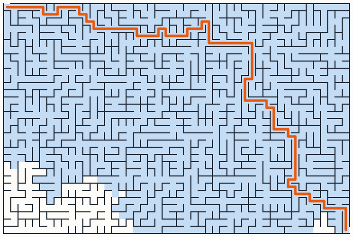
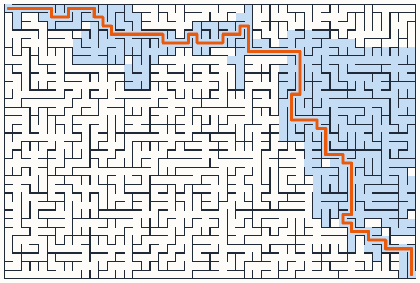
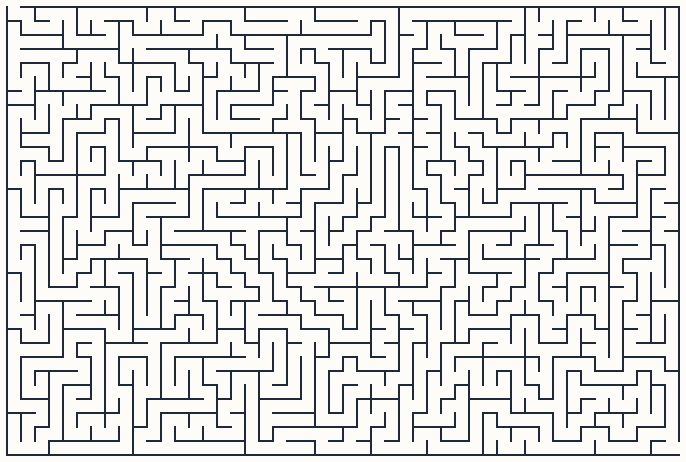
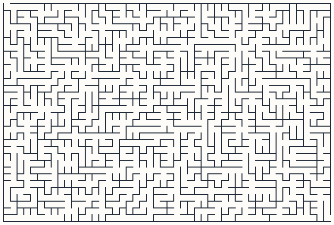

# 🧩 rust-maze

[](https://github.com/blackdalc7/rust-maze/actions/workflows/ci.yml)

A command line tool written in **Rust** that generates mazes with two different algorithms, solves them with **breadth-first search** or **A\***, and draws them in the terminal or as SVG pictures. It has **no dependencies**, not even for random numbers.

I wanted a first Rust project that was small enough to finish but still made me deal with ownership, iterators, enums and `Option`/`Result` properly. Mazes turned out to be perfect for that, and they look cool.

<p align="center">
  
  
  <br><em>The same maze solved twice. Blue cells are the ones each algorithm had to look at.<br>
  BFS (left) checks 92% of the maze; A* (right) heads towards the goal and checks only 30%.</em>
</p>

## Quick start

Install Rust from [rustup.rs](https://rustup.rs), then:

```bash
git clone https://github.com/blackdalc7/rust-maze.git
cd rust-maze
cargo run --release -- -w 12 -h 6 -s 7 --solve bfs
```

```
+---+---+---+---+---+---+---+---+---+---+---+---+
  o   o   o   o   o | o   o |               |   |
+---+---+---+---+   +   +   +---+   +   +   +   +
|               | o | o | o   o |   |   |       |
+   +---+---+   +   +   +---+   +---+   +---+   +
|   |       |   | o   o |   | o   o |   |       |
+   +   +   +   +---+---+   +---+   +   +---+   +
|   |   |               |       | o |       |   |
+   +---+---+---+---+   +   +   +   +---+   +---+
|   |               |       |   | o   o |       |
+   +   +---+---+   +---+---+---+---+   +---+   +
|               |                     o   o   o
+---+---+---+---+---+---+---+---+---+---+---+---+
12x6 Backtracker maze, seed 7, 10 dead ends, perfect: yes, generated in 8.87µs
Bfs: path length 21, explored 22 of 72 cells (31%) in 4.90µs
```

### Options

| Option | Meaning | Default |
|---|---|---|
| `-w`, `--width N` | width in cells (1–2000) | 20 |
| `-h`, `--height N` | height in cells (1–2000) | 10 |
| `-s`, `--seed N` | random seed, the same seed gives the same maze | current time |
| `-a`, `--algo NAME` | `backtracker` (or `dfs`) or `prim` | `backtracker` |
| `--solve NAME` | `bfs`, `astar` or `none` | `none` |
| `--svg FILE` | also save an SVG picture | |
| `--explored` | shade the cells the solver visited (SVG) | |
| `--quiet` | print only the stats, not the maze | |

```bash
cargo run --release -- -w 48 -h 32 -s 3 -a prim --solve astar --svg maze.svg --explored --quiet
```

## Two ways to build a maze

Both algorithms make a **perfect maze**: every cell can be reached, and there is exactly one path between any two cells. In graph terms the maze is a *spanning tree* of the grid, so it always has exactly `cells - 1` passages. The program checks this and prints `perfect: yes`.

<p align="center">
  
  
  <br><em>Left: recursive backtracker. Right: randomised Prim's. Same size, same seed.</em>
</p>

**Recursive backtracker (depth-first search).** Start in a corner. Pick a random unvisited neighbour, knock down the wall to it, and move there. When you're stuck, back up until you find a cell with unvisited neighbours. This gives long, twisty corridors and few dead ends. I used an explicit `Vec` as a stack instead of real recursion, so a 1000×1000 maze doesn't overflow the call stack.

**Randomised Prim's.** Start from a random cell and keep a list of "frontier" walls leading out of the maze so far. Repeatedly pick a random frontier wall; if the cell behind it isn't in the maze yet, knock the wall down and add that cell's walls to the frontier. This grows outwards like a blob and gives lots of short dead ends (about 3 times as many as the backtracker).

## Two ways to solve it

**BFS** explores outward in rings from the start, using a queue. It always finds the shortest path, but it doesn't know where the goal is, so it often explores almost everything.

**A\*** uses a priority queue (`BinaryHeap`) ordered by `f = g + h`, where `g` is the number of steps taken so far and `h` is the Manhattan distance to the goal. It explores the cells that look closest to the goal first. Because the Manhattan distance never overestimates, A* still finds the shortest path.

I measured how much of a 48×32 maze each solver explores, averaged over 50 seeds:

| Maze type | BFS explores | A* explores | Average path length |
|---|---|---|---|
| Recursive backtracker | 52% | 48% | 432 cells |
| Prim's | 88% | 37% | 92 cells |

A* helps a lot on Prim mazes but barely at all on backtracker mazes. Backtracker paths are so long and winding (432 steps to cross a 48×32 grid) that "head towards the goal" is a bad hint: the real path usually goes the wrong way first. Prim mazes have much more direct solutions, so the hint works. I didn't expect the difference to be that big.

## Code layout

```
src/
├── main.rs     argument parsing (no clap, just a match), running, printing stats
├── maze.rs     grid of wall bit-flags, carving, both generators, dead-end count
├── solve.rs    BFS, A*, reachability check
├── render.rs   ASCII and SVG output
└── rng.rs      xorshift64* random number generator + Fisher–Yates shuffle
```

Some Rust things I liked or learned:

- **Walls as bit flags.** Each cell is one `u8` where `N = 1, E = 2, S = 4, W = 8`. "Is the east wall open?" is just `cell & E != 0`, and `count_ones()` tells you how many openings a cell has (1 = dead end).
- **Enums + `match`.** `Algorithm` and `Solver` are enums, and the compiler complains if a `match` forgets a case.
- **`Option` everywhere.** `maze.step(cell, dir)` returns `None` at the edge of the grid, and the solvers return `None` if there's no path, instead of using -1 or panicking.
- **`let ... else`** in Prim's algorithm to skip frontier walls that point outside the grid.
- **No crates.** The random generator is about 20 lines (xorshift64* with a splitmix64 seed scramble), so the build is fast and there's nothing to download.

## Tests

```bash
cargo test
cargo clippy --all-targets -- -D warnings
cargo fmt --check
```

28 unit tests, including:

- both generators make **perfect mazes** for 20 seeds each (connected, with exactly `cells - 1` passages)
- the same seed gives the same maze
- a 400×400 maze generates without a stack overflow
- BFS and A* agree on the path length, and the path never walks through a wall
- A* explores fewer cells than BFS on average
- the ASCII drawing has the right size, entrance and exit, and the SVG contains the path and explored cells

## Ideas for later

- [ ] More generators: Kruskal's (with union–find) and Wilson's (loop-erased random walks)
- [ ] An animated SVG or GIF of the solver exploring
- [ ] Compile to WebAssembly and run it in the browser
- [ ] "Braid" mazes with loops, where BFS and DFS give different answers

## License

MIT, see [LICENSE](LICENSE).
